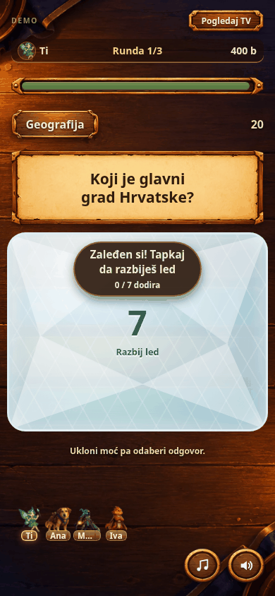
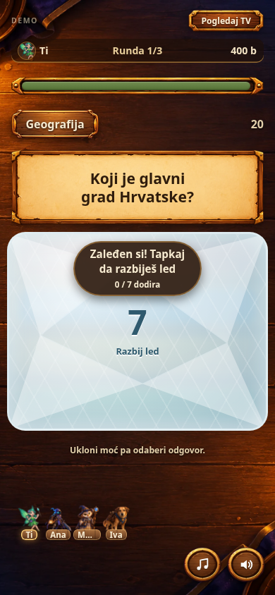
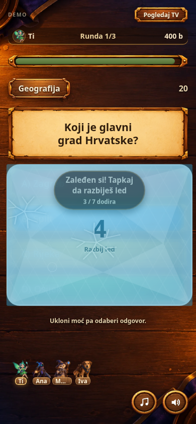
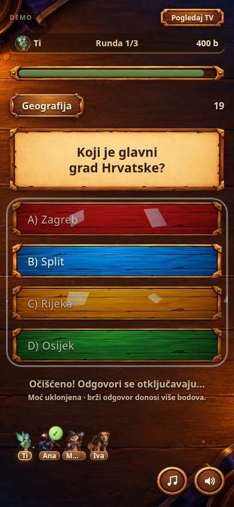

# Led — dorada postojeće moći

Snimka prikazuje stvarni UI u Chromiumu pri širini 390 px, s kontroliranim testnim stanjem. GIF nema zvuk; za zvuk pokreni igru iz ove grane.

## Što se promijenilo

- Postojeći efekt zaleđivanja dobio je slojeve ledenih ploha, uz iste boje leda i izvorne ploče odgovora.
- Pukotine nastaju točno na mjestu dodira i ostaju vidljive kroz svih sedam udaraca.
- Svaki udarac ima kratki vizualni odjek, postojeću vibraciju i postupno dublji zvuk pucanja. Zadnji udarac ima poseban naglasak.
- Završni udarac raspršuje 12 krhotina. One ne presreću dodire i uklanjaju se nakon animacije.
- Postojeća zaštita od slučajnog odgovora traje 900 ms nakon čišćenja. Pravilo od sedam udaraca i trajanje pitanja ostali su isti.
- Led radi i tipkama Enter/Space. Pri smanjenim animacijama nema trzanja i letećih krhotina.
- Postojeća scena bacanja moći, likovi, pergament, drvo i ostali dijelovi vizualnog identiteta zadržani su.

## Detalji

## Provjere

`python3 tests/test_mobile_feedback.py` provjerava položaje pukotina, osvježavanje stanja, završni efekt i čišćenje, zaštitu od slučajnog odgovora, slijed led → sluz, tipkovnicu, smanjene animacije, varijaciju reprodukcije zvuka i isključivanje zvuka. Obuhvaćene su i postojeće provjere odgovora i rezultata.

Provjere su izvršene u Chromiumu s mobilnim prikazom. Fizička vibracija i brzina na stvarnim mobitelima nisu izmjereni.

Promjene su na grani `codex/mobile-round-polish`; nisu spojene u `main` niti objavljene na postojećoj adresi igre.
