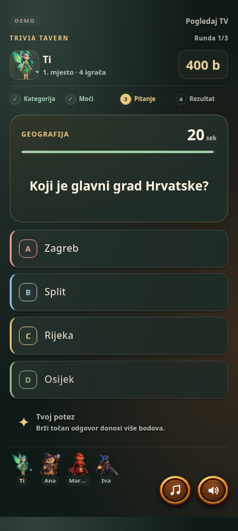
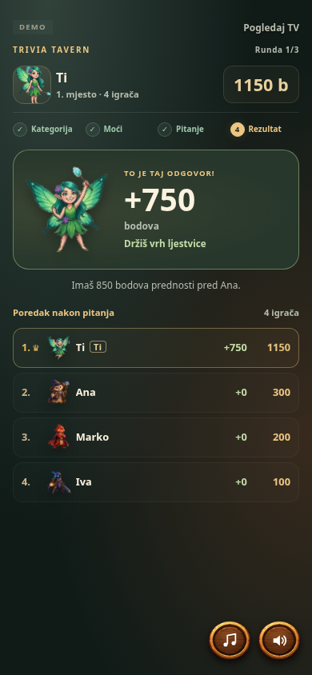

# Mobilna runda — probna verzija

Ova grana sadrži prijedlog mobilnog izgleda jedne runde. Nije spojena u `main` niti objavljena na postojećoj adresi igre.

## Pitanje



## Rezultat



Snimke su izrađene u Chromiumu na prikazu širine 390 px, s kontroliranim testnim stanjem igre.

## Što se promijenilo

- Mobilno zaglavlje s likom, bodovima, poretkom i koracima pitanja.
- Čitljivije kartice pitanja i odgovora, potvrda izbora i zvuk dodira.
- Prikaz napadača i spremnosti ostalih igrača.
- Osobni rezultat s reakcijom lika, osvojenim bodovima, promjenom mjesta i razlikom do suparnika.
- Predmemoriranje novog CSS-a za offline korištenje.

Pravila bodovanja i mrežni protokol ostali su nepromijenjeni.

## Isprobaj lokalno

Preuzmi ZIP ove grane kroz GitHub **Code → Download ZIP**, raspakiraj ga i pokreni iz mape projekta:

```sh
python3 -m http.server 8000
```

Otvori lokalni poslužitelj u pregledniku i odaberi **Igraj protiv botova**. Grana sama po sebi ne stvara javnu adresu za igranje.

## Provjere

- Demo: glasanje, izbor moći, pitanje, slanje odgovora i rezultat; bez JavaScript pogrešaka.
- Led, sluz i zaštita od slučajnog slanja odgovora nakon uklanjanja efekta.
- Točan/pogrešan odgovor, istek vremena, ulog i bonus saveza.
- Pravovremeno otkrivanje rezultata, uključujući reduced-motion postavku.
- Širine 320–430 px, vodoravni prikaz i dugački tekstovi.
- Spremanje novog CSS-a u service worker predmemoriju i otvaranje demo predvorja offline.

Mrežna igra između uređaja nije potvrđena u ovom okruženju zbog ograničenja pristupa vanjskim servisima.
