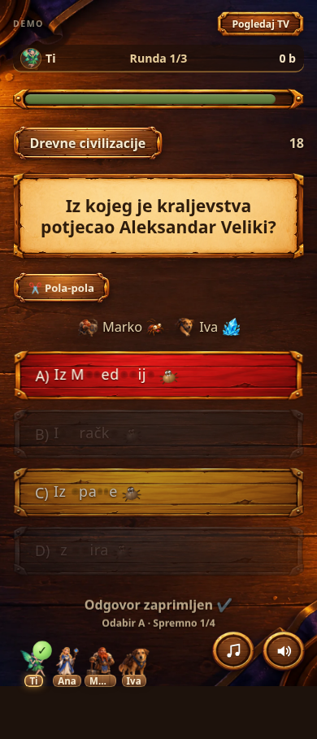
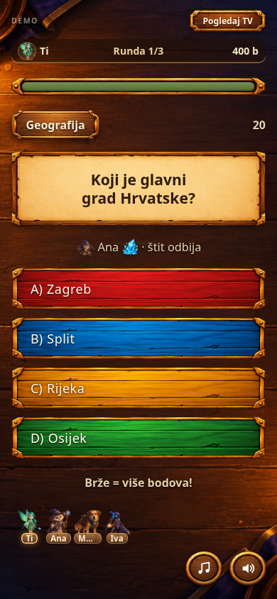

# Mobilna runda — dorade uz izvorni vizualni identitet

Ova grana zadržava izvornu paletu, drvene ploče, pergament, tipografiju, likove i raspored igre. Raniji prijedlog redizajna uklonjen je. Izvorni CSS iz verzije `e330708` ostao je sačuvan; novi stilovi ograničeni su na male oznake povratnih informacija i reakciju lika.

Grana nije spojena u `main` niti objavljena na postojećoj adresi igre.

## Pitanje


## Potvrda odgovora



## Napad i štit



## Rezultat


Snimke su izrađene u Chromiumu na prikazu širine 390 px. Potvrda odgovora snimljena je tijekom igre protiv botova; ostali prikazi koriste kontrolirana testna stanja.

## Zadržane dorade

- Zvuk i podržana vibracija pri odabiru kategorije, moći i mete.
- Potvrda odgovora s oznakom odabira i brojem spremnih igrača.
- Napredak pri razbijanju leda i čišćenju sluzi te potvrda uklanjanja moći.
- Protivnikov lik uz napad i jasna potvrda kada štit odbije napad.
- Reakcija vlastitog lika uz rezultat, koristeći postojeće ilustracije.
- Reakcija vlastitog lika nakon odgovora i ispravan prikaz likova koji nisu pod napadom.
- Imena uz likove i pravovremeno osvježavanje oznaka spremnosti ostalih igrača.
- Kratak tekst ispod rezultata: pomak na ljestvici i bodovna razlika do suparnika.

Izvorni prikaz pitanja, odgovora, moći i rezultata ostao je sačuvan. Pravila bodovanja i mrežni protokol ostali su nepromijenjeni.

## Isprobaj lokalno

Preuzmi ZIP ove grane kroz GitHub **Code → Download ZIP**, raspakiraj ga i pokreni iz mape projekta:

```sh
python3 -m http.server 8000
```

Otvori lokalni poslužitelj u pregledniku i odaberi **Igraj protiv botova**. Grana sama po sebi ne stvara javnu adresu za igranje.

## Provjere ispravka

- Potvrđeno da je izvorni blok CSS-a sačuvan bez promjena; dodatni stilovi ne mijenjaju boje, pozadine ili grafiku pitanja i odgovora.
- Prikaz širine 320–430 px i osvježavanje statusa ostalih igrača.
- Razbijanje leda, zaštita od slučajnog odgovora nakon čišćenja i potvrda izbora.
- Rezultat ostaje skriven do završetka otkrivanja; točan/pogrešan odgovor i istek vremena.
- JavaScript sintaksa i provjera pogrešaka u Chromiumu.

Mrežna igra između uređaja nije potvrđena u ovom okruženju zbog ograničenja pristupa vanjskim servisima.

## Ponovljive provjere

Za pregledničke provjere trebaju Python Playwright i Chromium. Pokreni:

```sh
python3 tests/test_mobile_feedback.py
```

Test sam pokreće privremeni HTTP poslužitelj i provjerava UI s kontroliranim stanjima. Ne dodaje testna sučelja u aplikaciju. `CHROMIUM_EXECUTABLE` može zadati putanju preglednika, a `MOZGALICA_SCREENSHOTS` mapu za snimke.

Dodatno je provjerena cijela demo runda kroz stvarno glasanje, odabir moći, slanje odgovora i prikaz rezultata, bez ubrizgavanja stanja.

## Dorada leda

[Animirana snimka i opis dovršene moći leda](ice-preview.md)
