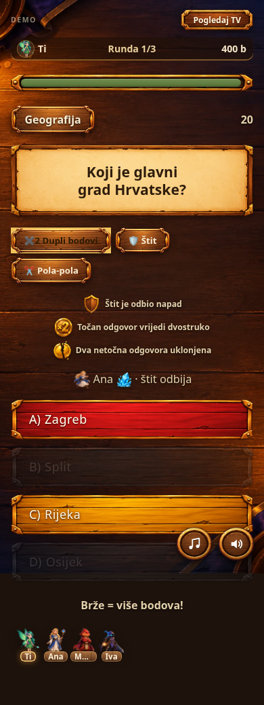
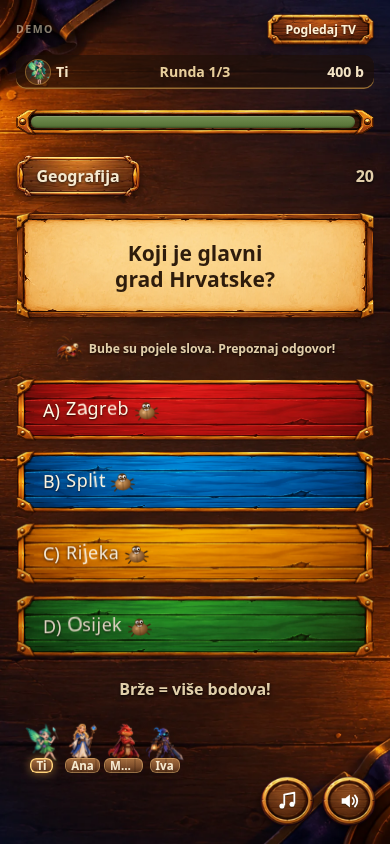

# Dorade svih moći

Sve moći koriste izvorne ilustracije, boje i ploče igre.

- **Led:** [snimka pucanja i rasprskavanja](ice-preview.md), pukotine prate dodir, promjenjiv zvuk i zaštita od slučajnog odgovora.
- **Sluz:** interpolacija brzih poteza uklanja praznine pri brisanju, zvuk prati novo očišćena područja, završne kapljice potvrđuju oslobađanje.
- **Bomba:** animirani fitilj, uputa da dodir izaziva eksploziju i jasna potvrda kratkog zaključavanja odgovora.
- **Grickalice:** postojeće grickanje slova dopunjeno je mrvicama i jasnim objašnjenjem učinka.
- **Štit:** reakcija ikone i potvrda da je napad odbijen.
- **Pola-pola:** kratka animacija aktivacije, uklonjeni odgovori ostaju onemogućeni i jasno označeni.
- **Dupli bodovi:** animacija aktivacije i objašnjenje nagrade; u finalu se prikazuje dodatni napredak.

Provjereno u Chromiumu kroz `python3 tests/test_mobile_feedback.py`: međudjelovanje moći, štit, uklonjeni odgovori, pojedena slova, bomba i zaključavanje odgovora, led/sluz, zvuk, tipkovnica, smanjene animacije i rezultati. Snimke koriste kontrolirana stanja. Ponašanje na stvarnim mobitelima i mrežna igra između uređaja još zahtijevaju provjeru.

Grana: `codex/mobile-round-polish`. Nije spojeno u `main`.
